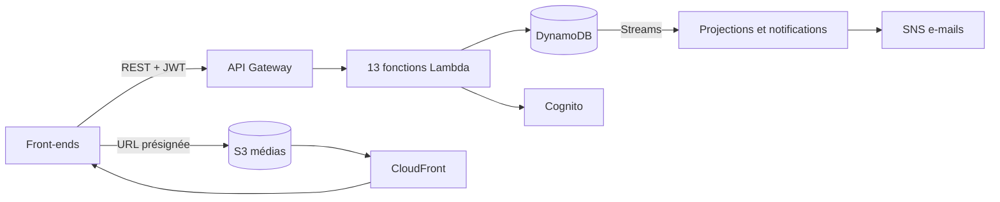

# Blogify — plateforme de blogging headless serverless sur AWS

Blogify est le **backend d'une plateforme de blogging sans interface graphique** (*headless CMS*)
destinée aux créateurs de contenu, journalistes et entreprises. Il expose une **API REST**
sécurisée que n'importe quel front-end (React, Next.js, Vue, application mobile, site statique…)
peut consommer, et repose exclusivement sur des **services serverless AWS** :
API Gateway, Lambda, DynamoDB, S3, Cognito, CloudFront, SNS, EventBridge et SQS.



## Fonctionnalités

| Exigence du projet | Implémentation |
|---|---|
| Authentification sécurisée des créateurs | Amazon Cognito (inscription, vérification d'e-mail, connexion, rafraîchissement et révocation des jetons, mot de passe oublié) + authorizer Lambda vérifiant les JWT |
| Rôles admin / éditeur / auteur invité | Groupes Cognito, matrice de permissions, contrôle de propriété ; administration des utilisateurs et des rôles par API |
| CRUD des articles via Lambda | `POST/GET/PATCH/DELETE /posts`, slugs uniques, Markdown, tags, extraits et temps de lecture automatiques, verrouillage optimiste (`ETag` / `If-Match`) |
| Stockage dans DynamoDB | Table unique (*single-table design*), 2 index secondaires, Streams, TTL, sauvegarde PITR |
| Médias sur S3 | Upload direct par **POST présigné** (taille et type imposés), validation de la signature binaire, diffusion **CloudFront** |
| API Gateway sécurisée | 42 routes REST, CORS, throttling global et par route, erreurs JSON homogènes, traçage X-Ray |
| *Optionnel* — Commentaires et modération | Commentaires anonymes modérés, file de modération, réponses, anti-spam (honeypot, limites de débit) |
| *Optionnel* — Recherche | `GET /search` : index inversé maintenu par DynamoDB Streams, classement par pertinence ; `GET /tags` |
| *Optionnel* — Notifications | Newsletter SNS (double opt-in, filtrage par tags) + événement EventBridge `PostPublished` pour les intégrations |

En plus : workflow éditorial (brouillon → relecture → publication / rejet / archivage),
documentation interactive **Swagger UI** servie par l'API (`/docs`), profils d'auteurs publics,
tests unitaires et d'intégration, smoke test sur l'infrastructure réelle, CI GitHub Actions.

## Démarrage rapide

Prérequis : Node.js ≥ 22, AWS CLI v2 configurée, AWS SAM CLI (Docker facultatif pour les tests
d'intégration).

```bash
npm ci                      # dépendances
npm test                    # tests unitaires
npm run deploy:guided       # build esbuild + sam deploy --guided (première fois)
npm run bootstrap-admin -- --email admin@example.com --password 'Admin-Passw0rd' --stack blogify-dev
npm run smoke -- --stack blogify-dev     # scénario de bout en bout sur la stack déployée
```

L'URL de l'API et celle de la documentation interactive sont affichées dans les sorties de la stack
(`ApiUrl`, `DocsUrl`). Le guide complet (paramètres, AWS Academy, supervision, suppression,
dépannage) est dans [docs/DEPLOYMENT.md](docs/DEPLOYMENT.md).

## Exemple d'utilisation

```bash
API=https://<id>.execute-api.<region>.amazonaws.com/dev

# 1. Inscription (rôle auteur invité) puis connexion
curl -s -X POST $API/auth/register -H 'Content-Type: application/json' \
  -d '{"email":"jeanne@example.com","password":"Passw0rd-Jeanne","name":"Jeanne"}'
TOKEN=$(curl -s -X POST $API/auth/login -H 'Content-Type: application/json' \
  -d '{"email":"jeanne@example.com","password":"Passw0rd-Jeanne"}' | jq -r .idToken)

# 2. Création d'un brouillon puis soumission à relecture
POST_ID=$(curl -s -X POST $API/posts -H "Authorization: Bearer $TOKEN" -H 'Content-Type: application/json' \
  -d '{"title":"Mon premier article","content":"# Bonjour\n\nÉcrit en **Markdown**.","tags":["aws","serverless"]}' | jq -r .id)
curl -s -X POST $API/posts/$POST_ID/submit -H "Authorization: Bearer $TOKEN"

# 3. Lecture publique (après publication par un éditeur)
curl -s "$API/posts?limit=5"
curl -s "$API/search?q=serverless"
```

## Documentation

| Document | Contenu |
|---|---|
| [docs/ARCHITECTURE.md](docs/ARCHITECTURE.md) | Vue d'ensemble, composants serverless, flux, modélisation DynamoDB, sécurité, résilience, choix techniques |
| [docs/API.md](docs/API.md) | Documentation de l'API : conventions, authentification, erreurs, pagination, référence de chaque route avec exemples |
| [docs/openapi.yaml](docs/openapi.yaml) | Spécification OpenAPI 3 (aussi servie par l'API : `GET /openapi.json`, interface `GET /docs`) |
| [docs/DEPLOYMENT.md](docs/DEPLOYMENT.md) | Guide de déploiement et de configuration |
| [docs/SCALABILITY.md](docs/SCALABILITY.md) | Recommandations d'évolutivité et d'optimisation des performances |
| [docs/PRESENTATION.md](docs/PRESENTATION.md) | Support de la présentation orale (plan et notes) |

## Structure du dépôt

```
template.yaml        Infrastructure as Code (AWS SAM)
src/lib/             Socle partagé (routeur HTTP, erreurs, validation, auth/RBAC, DynamoDB, textes)
src/domain/          Logique métier (articles, commentaires, médias, utilisateurs, recherche, tags, notifications)
src/functions/       Points d'entrée des 13 fonctions Lambda
tests/               Tests unitaires, d'intégration (DynamoDB Local) et utilitaires
scripts/             Build esbuild, smoke test, création d'administrateur, archive ZIP
events/              Événements d'exemple pour `sam local invoke`
docs/                Documentation
```

## Scripts npm

| Script | Description |
|---|---|
| `npm test` | Tests unitaires |
| `npm run test:integration` | Tests d'intégration sur DynamoDB Local (`npm run ddb:start` au préalable) |
| `npm run coverage` | Couverture de code des tests unitaires |
| `npm run build` | Bundle chaque fonction avec esbuild dans `dist/` |
| `npm run validate` | `sam validate --lint` |
| `npm run deploy:guided` / `npm run deploy` | Build + déploiement SAM (guidé / avec la configuration enregistrée) |
| `npm run bootstrap-admin -- --email … --password …` | Crée ou promeut un administrateur |
| `npm run smoke -- --stack …` | Smoke test de bout en bout sur la stack déployée |
| `npm run zip` | Archive `blogify-source.zip` du dépôt (dernier commit) pour le dépôt Moodle |
