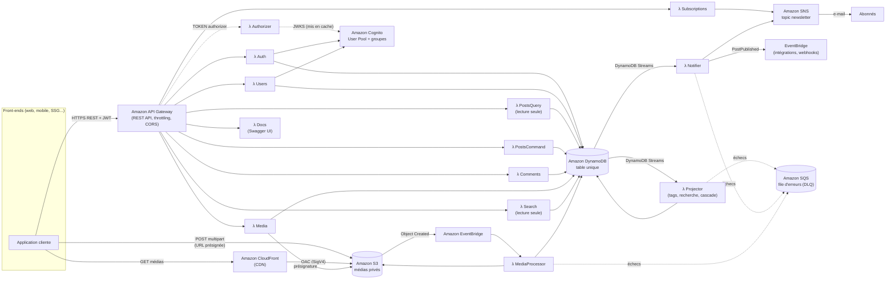
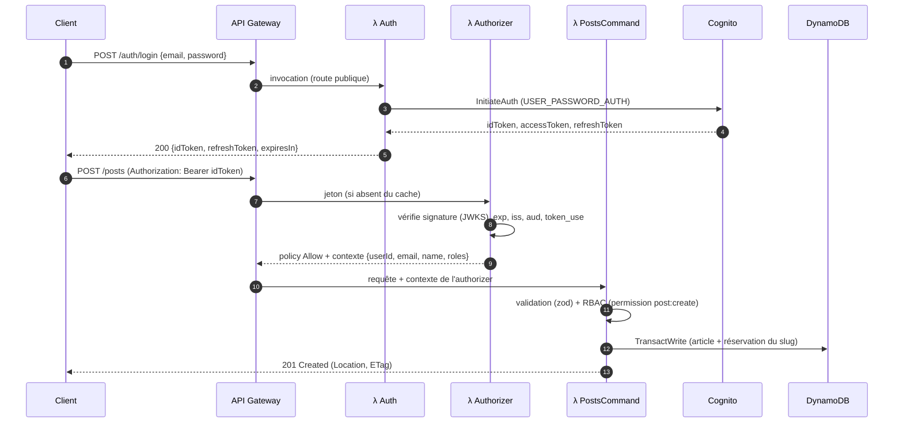
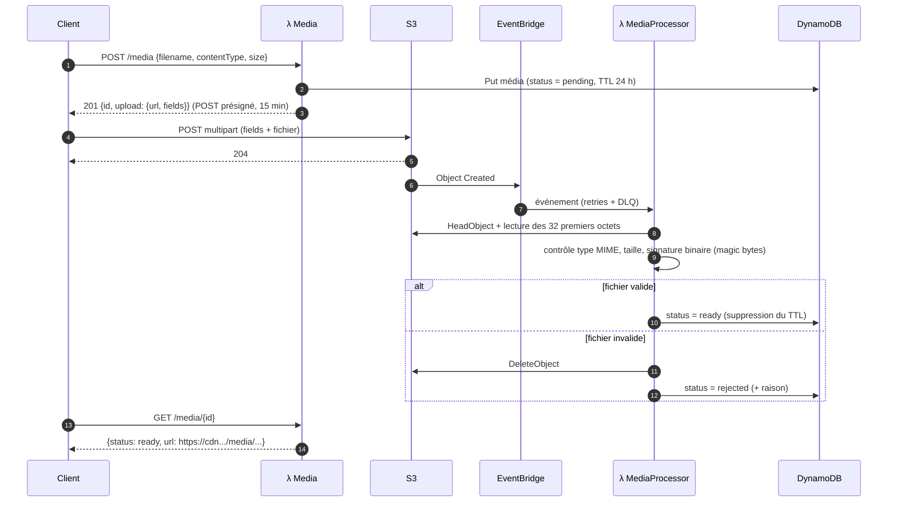
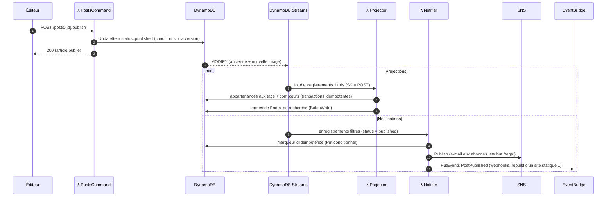
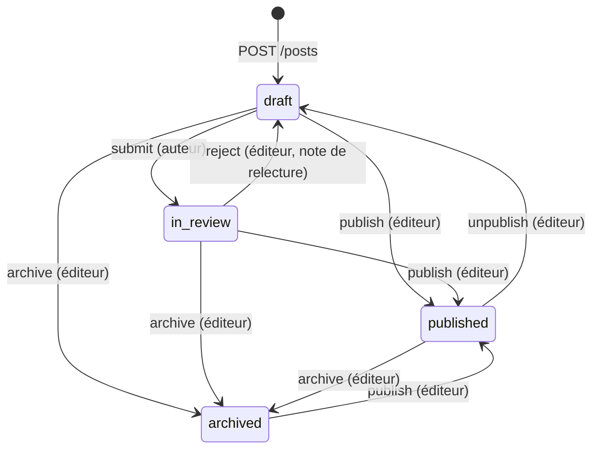

# Blogify — Vue d'ensemble et architecture du système

> Plateforme de blogging **headless** (sans interface graphique) 100 % **serverless** sur AWS.
> Le backend expose une API REST que n'importe quel front-end (site React/Next.js, application
> mobile, générateur de site statique, CMS d'entreprise…) peut consommer.

## Sommaire

1. [Objectifs et principes](#1-objectifs-et-principes)
2. [Architecture générale](#2-architecture-générale)
3. [Composants serverless](#3-composants-serverless)
4. [Flux principaux](#4-flux-principaux)
5. [Modélisation des données (DynamoDB)](#5-modélisation-des-données-dynamodb)
6. [Sécurité](#6-sécurité)
7. [Résilience, cohérence et observabilité](#7-résilience-cohérence-et-observabilité)
8. [Choix techniques justifiés](#8-choix-techniques-justifiés)
9. [Organisation du code](#9-organisation-du-code)

---

## 1. Objectifs et principes

| Besoin de Blogify | Réponse de l'architecture |
|---|---|
| Intégrable à n'importe quel front-end | API REST JSON documentée (OpenAPI 3 + Swagger UI), CORS configurable, aucune logique de présentation côté serveur |
| Authentification sécurisée des créateurs | Amazon Cognito (politique de mots de passe, vérification d'e-mail, jetons JWT signés) |
| Rôles admin / éditeur / auteur invité | Groupes Cognito + matrice de permissions appliquée dans chaque fonction |
| CRUD des articles via Lambda | Fonctions `PostsCommand` (écriture) et `PostsQuery` (lecture) |
| Stockage du contenu dans DynamoDB | Table unique en mode à la demande, 2 index secondaires globaux |
| Médias (images, vidéos) sur S3 | URL de téléversement présignées + validation asynchrone + diffusion CloudFront |
| Évolutivité et coûts maîtrisés | 100 % pay-per-use : aucun serveur, mise à l'échelle automatique, coût nul au repos (hors stockage) |
| Fonctionnalités optionnelles | Commentaires modérés, recherche plein texte, notifications aux abonnés : **toutes implémentées** |

Principes appliqués :

- **Serverless first** : uniquement des services managés (pas d'EC2, pas de conteneur à gérer).
- **Event-driven** : les effets de bord (index de recherche, compteurs de tags, notifications,
  validation des médias) sont traités de façon asynchrone par des événements
  (DynamoDB Streams, EventBridge), ce qui garde les requêtes HTTP rapides.
- **Moindre privilège** : un rôle IAM par fonction, limité aux seules actions nécessaires.
- **Infrastructure as Code** : toute l'infrastructure est décrite dans `template.yaml` (AWS SAM).
- **Défense en profondeur** : contrôle à la périphérie (authorizer, throttling) **et** dans le code
  (validation, RBAC, contrôle de propriété).

## 2. Architecture générale



Les traitements se répartissent en deux familles :

- **Synchrones** (chemin de la requête HTTP) : API Gateway → Lambda → DynamoDB / Cognito / S3.
  Ils ne font que le strict nécessaire pour répondre vite.
- **Asynchrones** (réactions à des événements) : DynamoDB Streams → `Projector` / `Notifier`,
  S3 → EventBridge → `MediaProcessor`. Ils sont rejoués automatiquement en cas d'erreur et
  aboutissent dans une file SQS (DLQ) après plusieurs échecs.

## 3. Composants serverless

| Composant | Service AWS | Rôle |
|---|---|---|
| API REST | Amazon API Gateway (REST, régional) | Routage de 42 routes, CORS, throttling global et par route, réponses d'erreur JSON uniformes (Gateway Responses), traçage X-Ray |
| Authentification | Amazon Cognito User Pool | Comptes, mots de passe, vérification d'e-mail, jetons JWT (ID / accès / rafraîchissement), groupes `admin`, `editor`, `guest-author` |
| Authorizer | AWS Lambda (TOKEN authorizer) | Vérifie la signature et les claims du jeton d'identité Cognito ; résultat mis en cache 5 min par jeton |
| Logique métier | 13 fonctions AWS Lambda (Node.js 24, arm64) | Une fonction par contexte métier (voir tableau ci-dessous) |
| Données | Amazon DynamoDB (à la demande) | Articles, commentaires, médias, profils, index de tags et de recherche ; Streams activés ; TTL ; PITR |
| Médias | Amazon S3 + Amazon CloudFront | Bucket privé chiffré, URL présignées pour l'upload, diffusion mondiale via CDN avec Origin Access Control |
| Événements | Amazon EventBridge | Notifications S3 « Object Created » et événements métier `PostPublished` |
| Notifications | Amazon SNS | Newsletter par e-mail avec double opt-in et filtrage par tags |
| Gestion des erreurs | Amazon SQS | File de lettres mortes (DLQ) pour les traitements asynchrones |
| Observabilité | Amazon CloudWatch Logs + AWS X-Ray | Journaux JSON structurés (rétention configurable), traces distribuées |

### Fonctions Lambda

| Fonction | Déclencheur | Routes / responsabilité | Permissions principales |
|---|---|---|---|
| `AuthorizerFunction` | API Gateway (authorizer) | Vérification des jetons Cognito | aucune (JWKS public) |
| `AuthFunction` | API Gateway | `/auth/*` : inscription, confirmation, connexion, rafraîchissement, mot de passe oublié, déconnexion | 3 actions Cognito admin, DynamoDB |
| `UsersFunction` | API Gateway | `/me`, `/authors/{userId}`, `/users` (administration des rôles) | Cognito admin (pool unique), DynamoDB |
| `PostsQueryFunction` | API Gateway | `GET /posts`, `GET /posts/{postId}` | **lecture seule** DynamoDB |
| `PostsCommandFunction` | API Gateway | Création, modification, suppression, workflow éditorial | DynamoDB CRUD |
| `CommentsFunction` | API Gateway | Commentaires et modération | DynamoDB CRUD |
| `MediaFunction` | API Gateway | Médiathèque, URL présignées | DynamoDB, S3 (bucket médias) |
| `MediaProcessorFunction` | EventBridge (S3) | Validation des fichiers téléversés (taille, type, signature binaire) | DynamoDB, S3 |
| `SearchFunction` | API Gateway | `GET /search`, `GET /tags` | **lecture seule** DynamoDB |
| `SubscriptionsFunction` | API Gateway | Abonnements à la newsletter | `sns:Subscribe`, `sns:ListSubscriptionsByTopic` (un topic) |
| `ProjectorFunction` | DynamoDB Streams | Index de tags, index de recherche, suppression en cascade | DynamoDB, SQS (DLQ) |
| `NotifierFunction` | DynamoDB Streams | E-mails aux abonnés + événement `PostPublished` | DynamoDB, SNS (un topic), EventBridge, SQS |
| `DocsFunction` | API Gateway | `GET /docs` (Swagger UI), `GET /openapi.json`, `GET /health` | aucune |

## 4. Flux principaux

### 4.1 Authentification et appel d'une route protégée



### 4.2 Téléversement d'un média



Le fichier ne transite **jamais** par API Gateway ni par Lambda (limites de 10 Mo / 6 Mo évitées,
pas de coût de calcul pour la bande passante). La politique du POST présigné impose côté S3 la
taille maximale et le type de contenu déclarés.

### 4.3 Publication d'un article et réactions asynchrones



### 4.4 Workflow éditorial



Un auteur invité ne peut jamais publier lui-même : il soumet son brouillon, qu'un éditeur ou un
administrateur relit puis publie (ou rejette avec une note).

## 5. Modélisation des données (DynamoDB)

### 5.1 Pourquoi une table unique ?

Toutes les entités sont stockées dans **une seule table** (`single-table design`) avec des clés
génériques `PK` / `SK` et deux index secondaires globaux surchargés (`GSI1`, `GSI2`).
Chaque motif d'accès est servi par **une seule requête `Query` ou `GetItem`**, sans jointure ni
`Scan`, avec une latence prévisible de quelques millisecondes quelle que soit la volumétrie.

| Entité | PK | SK | GSI1PK / GSI1SK | GSI2PK / GSI2SK |
|---|---|---|---|---|
| Article | `POST#<postId>` | `POST` | `POSTS#<status>` / `<date>#<postId>` | `USER#<authorId>` / `POST#<createdAt>#<postId>` |
| Réservation de slug | `SLUG#<slug>` | `SLUG` | – | – |
| Commentaire | `POST#<postId>` | `COMMENT#<commentId>` | `COMMENTS#<status>` / `<createdAt>#<commentId>` | – |
| Marqueur de notification | `POST#<postId>` | `NOTIFICATION` | – | – |
| Média | `MEDIA#<mediaId>` | `MEDIA` | `MEDIA` / `<createdAt>#<mediaId>` | `USER#<ownerId>` / `MEDIA#<createdAt>#<mediaId>` |
| Profil | `USER#<userId>` | `PROFILE` | – | – |
| Appartenance à un tag (projection) | `TAG#<tag>` | `POST#<postId>` | `TAG#<tag>` / `<publishedAt>#<postId>` | – |
| Compteur de tag (projection) | `TAGS` | `TAG#<tag>` | – | – |
| Terme de recherche (projection) | `TERM#<terme>` | `POST#<postId>` | – | – |

Pour un article publié, `<date>` vaut `publishedAt` ; pour les autres statuts, `updatedAt`.
Les identifiants sont des **UUID v7** : ils sont ordonnés dans le temps, ce qui trie naturellement
les commentaires par date de création dans la partition de leur article.

### 5.2 Motifs d'accès

| # | Motif d'accès | Opération |
|---|---|---|
| AP1 | Lire un article par identifiant | `GetItem PK=POST#id, SK=POST` |
| AP2 | Lire un article par slug | `GetItem SLUG#slug` → `GetItem` article |
| AP3 | Lister les articles publiés (plus récents d'abord) | `Query GSI1 PK=POSTS#published` (ordre décroissant) |
| AP4 | File de relecture des éditeurs / brouillons | `Query GSI1 PK=POSTS#in_review` (ou `draft`, `archived`) |
| AP5 | Articles d'un auteur | `Query GSI2 PK=USER#id, SK begins_with POST#` |
| AP6 | Articles publiés d'un tag | `Query GSI1 PK=TAG#tag` |
| AP7 | Nuage de tags avec compteurs | `Query PK=TAGS` |
| AP8 | Recherche plein texte | `Query PK=TERM#terme` par terme, puis classement |
| AP9 | Commentaires d'un article (chronologiques) | `Query PK=POST#id, SK begins_with COMMENT#` |
| AP10 | File de modération | `Query GSI1 PK=COMMENTS#pending` (plus anciens d'abord) |
| AP11 | Médiathèque complète / d'un utilisateur | `Query GSI1 PK=MEDIA` / `Query GSI2 PK=USER#id, SK begins_with MEDIA#` |
| AP12 | Profil d'un auteur | `GetItem PK=USER#id, SK=PROFILE` |
| AP13 | Unicité d'un slug | `TransactWrite` avec `attribute_not_exists` sur `SLUG#slug` |

### 5.3 Exemple d'article stocké

```json
{
  "PK": "POST#0192f5a1-7c2b-7d3e-8f40-0a1b2c3d4e5f",
  "SK": "POST",
  "entityType": "POST",
  "postId": "0192f5a1-7c2b-7d3e-8f40-0a1b2c3d4e5f",
  "slug": "architecture-serverless-avec-aws-lambda",
  "title": "Architecture serverless avec AWS Lambda",
  "content": "# Introduction\n\nMarkdown complet de l'article...",
  "excerpt": "Introduction Markdown complet de l'article...",
  "tags": ["aws", "serverless"],
  "status": "published",
  "authorId": "33333333-3333-4333-8333-333333333333",
  "authorName": "Gaby Guest",
  "readingTimeMinutes": 4,
  "commentCount": 2,
  "allowComments": true,
  "createdAt": "2026-10-27T09:00:00.000Z",
  "updatedAt": "2026-10-27T10:00:00.000Z",
  "publishedAt": "2026-10-27T10:00:00.000Z",
  "version": 3,
  "GSI1PK": "POSTS#published",
  "GSI1SK": "2026-10-27T10:00:00.000Z#0192f5a1-7c2b-7d3e-8f40-0a1b2c3d4e5f",
  "GSI2PK": "USER#33333333-3333-4333-8333-333333333333",
  "GSI2SK": "POST#2026-10-27T09:00:00.000Z#0192f5a1-7c2b-7d3e-8f40-0a1b2c3d4e5f"
}
```

### 5.4 Décisions de modélisation

- **Projection sélective des index (`INCLUDE`)** : les GSI ne copient que les attributs utiles aux
  listes (titre, extrait, tags, auteur, dates…) et **pas le corps des articles**. Les listes
  consomment ainsi peu de capacité de lecture et les écritures dans les index restent petites.
  Le catalogue des attributs projetés est centralisé dans `src/lib/schema.mjs` et un test vérifie
  qu'il correspond exactement au template.
- **Dénormalisation maîtrisée** : le nom de l'auteur est copié dans l'article, le titre de l'article
  dans le commentaire (contexte pour les modérateurs) et le résumé de l'article dans les éléments
  de tags et de recherche, pour éviter toute lecture supplémentaire.
- **Vues matérialisées par événements** : les index de tags et de recherche sont recalculés par la
  fonction `Projector` à partir du flux DynamoDB (ancienne et nouvelle image). Ils sont donc
  **cohérents à terme** (en pratique en moins d'une seconde).
- **Unicité des slugs** : un élément `SLUG#<slug>` est écrit dans la même transaction que l'article ;
  la condition `attribute_not_exists` garantit qu'aucun slug n'est attribué deux fois.
- **Concurrence optimiste** : chaque article porte un numéro `version` ; l'API renvoie un en-tête
  `ETag` et accepte `If-Match` (réponse `412` si l'article a été modifié entre-temps).
- **Compteurs atomiques** : `commentCount` est mis à jour par `ADD` dans une transaction avec le
  commentaire (jamais par réécriture complète de l'article).
- **TTL** : les médias en attente d'upload expirent automatiquement après 24 h (attribut `expiresAt`).
- **Pagination par curseur** : `LastEvaluatedKey` est encodé en base64url dans un `nextCursor` opaque ;
  aucune pagination par `offset` (coûteuse et instable).

## 6. Sécurité

### 6.1 Authentification

- **Amazon Cognito** gère les comptes : politique de mots de passe (8 caractères minimum, majuscule,
  minuscule, chiffre), vérification de l'adresse e-mail par code, récupération de compte par e-mail,
  messages d'erreur ne révélant pas l'existence d'un compte (`PreventUserExistenceErrors`).
- Les clients envoient le **jeton d'identité** (`idToken`, durée de vie 60 min) dans l'en-tête
  `Authorization: Bearer <idToken>` ; le `refreshToken` (30 jours) permet d'en obtenir un nouveau et
  peut être révoqué (`POST /auth/logout`).
- L'**authorizer Lambda** vérifie cryptographiquement chaque jeton (signature RS256 via les clés
  publiques JWKS de Cognito, expiration, émetteur, audience = client de l'application,
  `token_use = id`). API Gateway rejette (`401`) toute requête invalide **avant** d'invoquer la
  logique métier et met le résultat en cache 5 minutes par jeton.
- Les routes publiques qui acceptent un jeton optionnel (ex. `GET /posts/{id}` pour qu'un auteur
  relise son brouillon) le vérifient avec **le même module** (`aws-jwt-verify`).

### 6.2 Autorisation (RBAC)

Les rôles sont des **groupes Cognito** ; le claim `cognito:groups` du jeton est converti en liste de
rôles, puis en permissions (`src/lib/auth.mjs`). Les nouveaux inscrits reçoivent le rôle le plus
faible (`guest-author`) ; seul un administrateur peut promouvoir un utilisateur.

| Permission | admin | editor | guest-author | anonyme |
|---|:-:|:-:|:-:|:-:|
| Lire les articles publiés, commentaires approuvés, tags, recherche | ✔ | ✔ | ✔ | ✔ |
| Commenter (modération si anonyme) / s'abonner | ✔ | ✔ | ✔ | ✔ |
| Créer un article (brouillon) | ✔ | ✔ | ✔ | |
| Modifier / supprimer **ses** brouillons, les soumettre à relecture | ✔ | ✔ | ✔ | |
| Lire, modifier, supprimer **tous** les articles | ✔ | ✔ | | |
| Publier, dépublier, rejeter, archiver | ✔ | ✔ | | |
| Modérer les commentaires | ✔ | ✔ | | |
| Téléverser des médias / gérer **ses** médias | ✔ | ✔ | ✔ | |
| Gérer **tous** les médias | ✔ | ✔ | | |
| Gérer les utilisateurs et les rôles, inviter | ✔ | | | |
| Consulter la liste des abonnés | ✔ | | | |

En plus des permissions, le code vérifie la **propriété** des ressources (un auteur invité ne
modifie que ses propres articles, et seulement tant qu'ils ne sont pas publiés). Une ressource que
l'appelant n'a pas le droit de voir (le brouillon d'un autre) renvoie **404** et non 403, pour ne
pas révéler son existence. Un administrateur ne peut ni se rétrograder ni se désactiver lui-même.

### 6.3 Moindre privilège et protection des données

- **Un rôle IAM par fonction**, généré par SAM avec des politiques ciblées : les fonctions publiques
  de lecture (`PostsQuery`, `Search`) n'ont **aucun droit d'écriture** ; seules `Users` et `Auth`
  parlent à Cognito, et uniquement sur le user pool de la stack ; `Media` n'accède qu'au bucket
  des médias ; `Notifier` ne publie que sur un topic SNS.
- **Chiffrement au repos** partout (DynamoDB, S3 SSE-S3, SQS SSE) et **en transit** (TLS imposé :
  la politique du bucket refuse toute requête non chiffrée, CloudFront redirige vers HTTPS).
- **Bucket S3 privé** (Block Public Access, propriété des objets imposée) ; lecture publique
  uniquement via CloudFront avec **Origin Access Control** et en-têtes de sécurité gérés.
- **Sauvegarde continue** de la table (Point-In-Time Recovery, 35 jours).

### 6.4 Validation des entrées et des fichiers

- Chaque corps de requête et chaque paramètre est validé par un **schéma strict** (zod) : types,
  longueurs, formats (e-mail, URL, UUID, slug), champs inconnus refusés ; corps limité à 1 Mio.
- Les **médias** : types autorisés en liste blanche (JPEG, PNG, GIF, WebP, AVIF, MP4, WebM,
  QuickTime — le SVG est refusé car il peut contenir du JavaScript), taille maximale configurable,
  URL d'upload valable 15 minutes, conditions `content-length-range` et `Content-Type` imposées par
  S3, puis **vérification de la signature binaire** (magic bytes) par `MediaProcessor` : un fichier
  dont le contenu ne correspond pas au type déclaré est supprimé.
- Le contenu Markdown est stocké tel quel : c'est au front-end de l'assainir lors du rendu HTML
  (ex. DOMPurify), comme pour tout CMS headless.

### 6.5 Protection contre les abus

- **Throttling API Gateway** : 100 req/s (rafale 200) par défaut, limites renforcées sur
  `/auth/register` (5 req/s), `/auth/login` (10 req/s), `/auth/forgot-password` (2 req/s),
  la création de commentaires (5 req/s) et les abonnements (2 req/s).
- **Commentaires** : modération obligatoire pour les anonymes, champ *honeypot* anti-robots,
  e-mails des lecteurs jamais exposés publiquement.
- **Newsletter** : double opt-in natif de SNS (e-mail de confirmation) et lien de désabonnement
  dans chaque message.
- **Pas d'énumération de comptes** : `POST /auth/forgot-password` répond toujours `202`.

## 7. Résilience, cohérence et observabilité

| Mécanisme | Mise en œuvre |
|---|---|
| Rejeu des traitements asynchrones | Streams : 5 tentatives, découpage du lot en cas d'erreur (`BisectBatchOnFunctionError`), échecs partiels (`ReportBatchItemFailures`) ; EventBridge : 3 tentatives sur 1 h |
| Lettres mortes | File SQS `ProcessingDLQ` (rétention 14 jours) pour les enregistrements qui échouent définitivement |
| Idempotence | Compteurs de tags modifiés uniquement via des transactions conditionnelles ; marqueur de notification (`Put` conditionnel) empêchant les e-mails en double ; traitement des médias ignoré s'il a déjà eu lieu |
| Ordre des événements | Traitement séquentiel des enregistrements d'un lot ; arrêt au premier échec pour préserver l'ordre par article |
| Concurrence | Verrouillage optimiste (`version` / `If-Match`), conditions DynamoDB, transactions |
| Journaux | Format JSON natif de Lambda, groupe de logs dédié avec rétention, requêtes CloudWatch Logs Insights possibles sur `requestId`, `route`, `status`, `durationMs` |
| Traces | AWS X-Ray activé sur API Gateway et toutes les fonctions |
| Santé | `GET /health` (supervision externe) |

## 8. Choix techniques justifiés

| Choix | Alternatives considérées | Justification |
|---|---|---|
| **API Gateway REST** | HTTP API | Throttling par route, Gateway Responses personnalisées, intégration WAF, cache et plans d'usage disponibles pour la montée en charge |
| **Authorizer Lambda + Cognito** | Authorizer Cognito natif | Accepte `Bearer <jeton>` comme le jeton brut, contrôle total des claims transmis (rôles normalisés), même code de vérification pour les routes à authentification optionnelle |
| **Une Lambda par contexte métier** | Une Lambda par route / une seule Lambda | Bon compromis : permissions IAM ciblées, déploiements indépendants, moins de démarrages à froid qu'avec 42 micro-fonctions |
| **Séparation lecture / écriture des articles (CQRS léger)** | Une seule fonction | Le trafic public (lecture) est isolé, en lecture seule, et peut être dimensionné à part (concurrence provisionnée, cache) |
| **Node.js 24 sur arm64 (Graviton)** | x86_64, Python | Environ 20 % moins cher et souvent plus rapide ; SDK AWS v3 modulaire |
| **Bundles esbuild** | Déploiement de `node_modules` | Une fonction = un fichier minifié et *tree-shaké* de quelques centaines de Ko : démarrages à froid plus courts |
| **DynamoDB à la demande, table unique** | RDS/Aurora, plusieurs tables | Aucune capacité à provisionner, latence constante, paiement à la requête, Streams pour l'event-driven |
| **Recherche par index inversé DynamoDB** | Amazon OpenSearch | Coût nul au repos (OpenSearch Serverless coûte plusieurs centaines de $/mois) ; OpenSearch reste l'évolution recommandée à grande échelle (voir `SCALABILITY.md`) |
| **S3 → EventBridge** | Notification S3 directe vers Lambda | Pas de dépendance circulaire dans CloudFormation, règles filtrables, retries et DLQ intégrés |
| **SNS pour la newsletter** | Amazon SES | Double opt-in et désabonnement gérés nativement, filtrage par tags ; SES est recommandé pour des e-mails HTML |
| **AWS SAM** | Serverless Framework, CDK, Terraform | Outil officiel AWS, syntaxe CloudFormation, tests locaux (`sam local`), aucun compte tiers |

## 9. Organisation du code

```
.
├── template.yaml              # Infrastructure (AWS SAM / CloudFormation)
├── samconfig.toml             # Paramètres de déploiement par défaut
├── src/
│   ├── lib/                   # Socle partagé : HTTP/routeur, erreurs, validation, auth/RBAC,
│   │                          # DynamoDB (clés, pagination, batch), config, logs, textes
│   ├── domain/                # Logique métier (articles, commentaires, médias, utilisateurs,
│   │                          # recherche, tags, notifications)
│   └── functions/<nom>/       # Points d'entrée Lambda (un dossier par fonction)
├── tests/
│   ├── unit/                  # Tests unitaires (node:test + mocks du SDK AWS)
│   ├── integration/           # Scénario de bout en bout sur DynamoDB Local (+ rejeu des Streams)
│   └── helpers/               # Générateurs d'événements, de JWT, lecture du template
├── scripts/                   # Build esbuild, smoke test, création d'admin, archive ZIP
├── events/                    # Événements d'exemple pour `sam local invoke`
└── docs/                      # Documentation (architecture, API, déploiement, scalabilité, OpenAPI)
```

Chaque fonction Lambda suit le même schéma : **router** (`createApiHandler`) → **validation**
→ **contrôle d'accès** → **logique métier** (`src/domain`) → **réponse JSON**. Les erreurs sont
converties en réponses homogènes :

```json
{ "error": { "code": "VALIDATION_ERROR", "message": "Request validation failed",
             "details": [{ "field": "title", "message": "Too small: expected string to have >=1 characters" }] },
  "requestId": "c6af9ac6-7b61-11e6-9a41-93e8deadbeef" }
```
